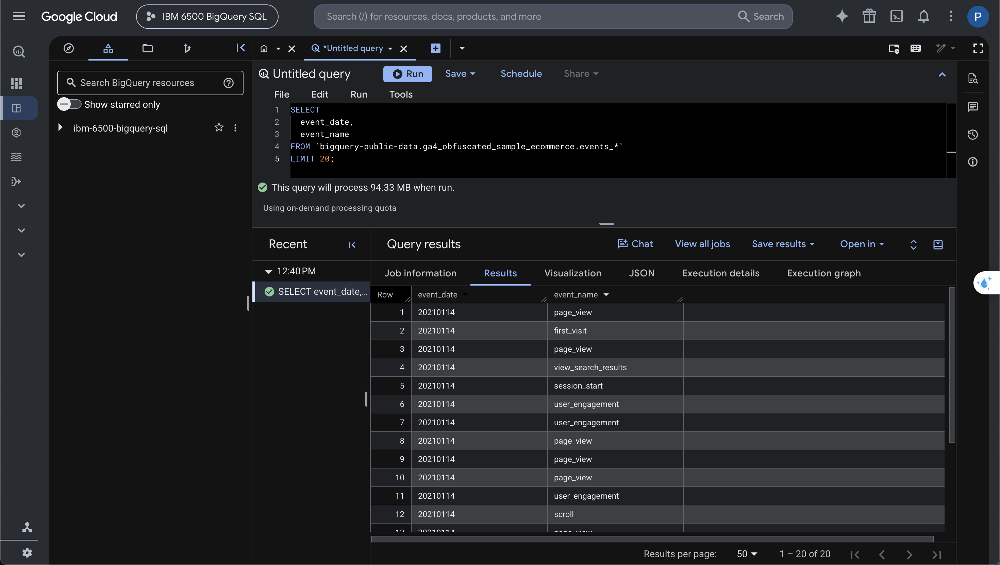
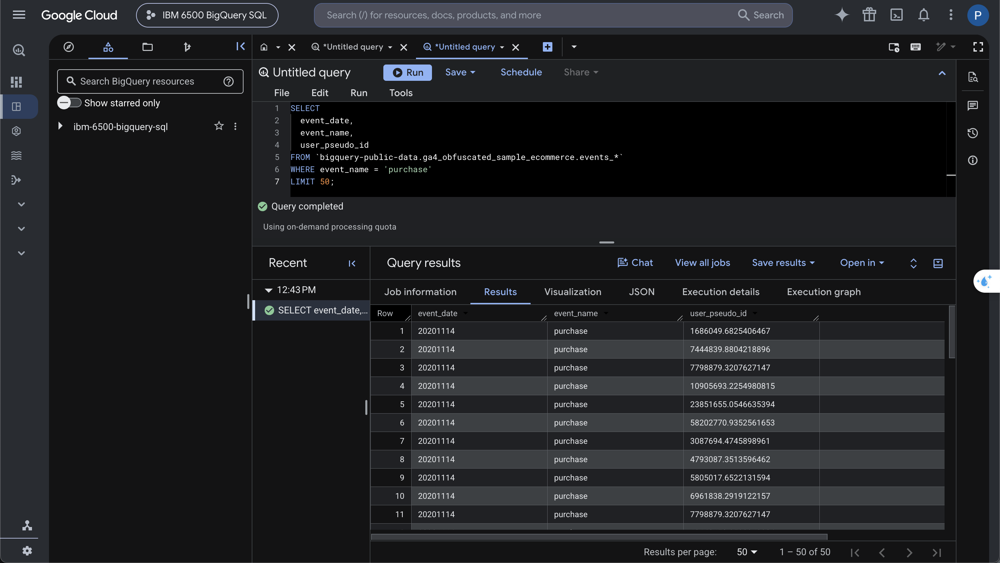
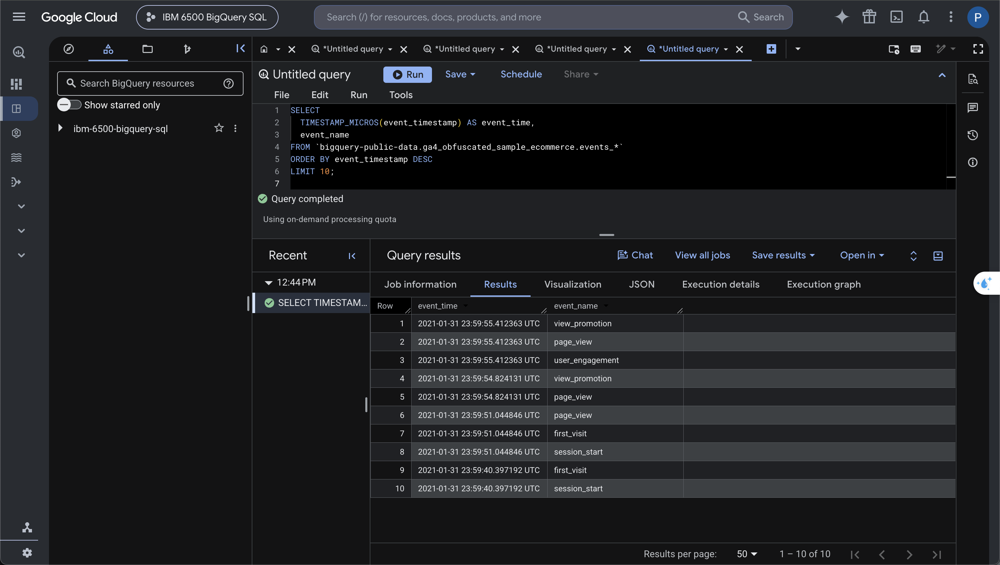
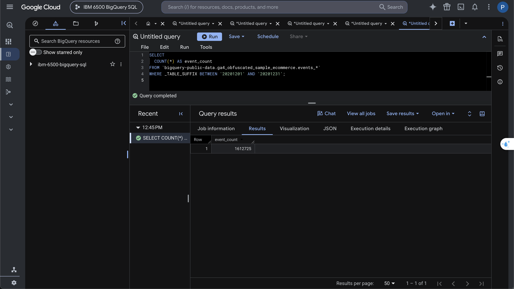
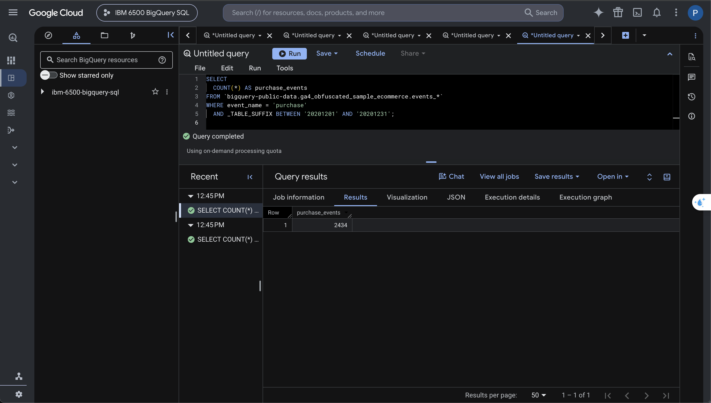
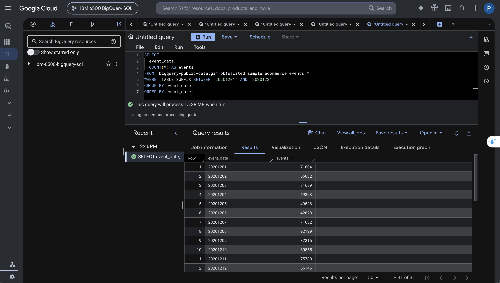
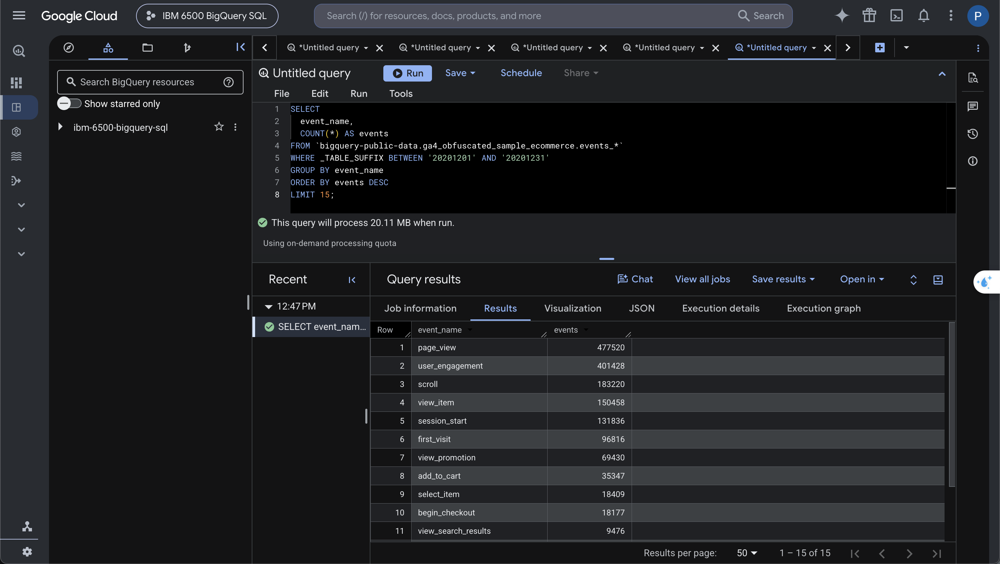
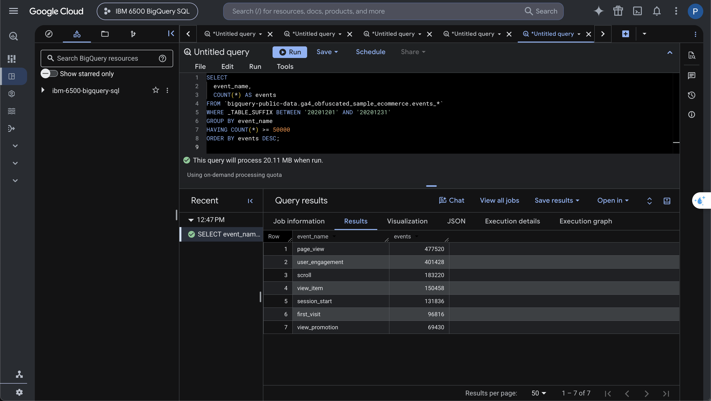
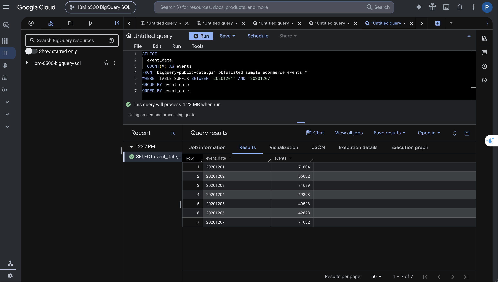

# SELECT, FROM, and LIMIT

## Query 1: Selecting and Limiting Rows

This query selects the event date and event name from the GA4 dataset. `LIMIT 20` restricts the displayed output to 20 rows.

``` sql
SELECT
  event_date,
  event_name
FROM `bigquery-public-data.ga4_obfuscated_sample_ecommerce.events_*`
LIMIT 20;
```

{fig-alt="BigQuery output showing event dates and event names"}

# Filtering and Sorting

## Query 2: Filtering Purchase Events

This query uses `WHERE` to keep only events with the name `purchase`. It also displays the date and anonymous user identifier.

``` sql
SELECT
  event_date,
  event_name,
  user_pseudo_id
FROM `bigquery-public-data.ga4_obfuscated_sample_ecommerce.events_*`
WHERE event_name = 'purchase'
LIMIT 50;
```

{fig-alt="BigQuery output showing purchase events"}

## Query 3: Sorting Purchase Events

This query keeps purchase events and sorts them from the newest timestamp to the oldest.

``` sql
SELECT
  event_date,
  event_timestamp,
  event_name
FROM `bigquery-public-data.ga4_obfuscated_sample_ecommerce.events_*`
WHERE event_name = 'purchase'
ORDER BY event_timestamp DESC
LIMIT 20;
```

{fig-alt="Purchase events sorted by timestamp"}

## Query 4: Creating Readable Timestamps

GA4 stores timestamps in microseconds. `TIMESTAMP_MICROS()` converts them into a readable date and time.

``` sql
SELECT
  TIMESTAMP_MICROS(event_timestamp) AS event_time,
  event_name
FROM `bigquery-public-data.ga4_obfuscated_sample_ecommerce.events_*`
ORDER BY event_timestamp DESC
LIMIT 10;
```

{fig-alt="GA4 events with readable timestamps"}

# Summary Functions

## Query 5: Counting All Events

This query counts the total number of events recorded during December 2020.

``` sql
SELECT
  COUNT(*) AS event_count
FROM `bigquery-public-data.ga4_obfuscated_sample_ecommerce.events_*`
WHERE _TABLE_SUFFIX BETWEEN '20201201' AND '20201231';
```

{fig-alt="Total event count for December 2020"}

## Query 6: Counting Purchases

This query counts only purchase events recorded during December 2020.

``` sql
SELECT
  COUNT(*) AS purchase_events
FROM `bigquery-public-data.ga4_obfuscated_sample_ecommerce.events_*`
WHERE event_name = 'purchase'
  AND _TABLE_SUFFIX BETWEEN '20201201' AND '20201231';
```

{fig-alt="Purchase event count for December 2020"}

# Grouping Results

## Query 7: Events by Day

This query groups the data by date so that each result row represents one day.

``` sql
SELECT
  event_date,
  COUNT(*) AS events
FROM `bigquery-public-data.ga4_obfuscated_sample_ecommerce.events_*`
WHERE _TABLE_SUFFIX BETWEEN '20201201' AND '20201231'
GROUP BY event_date
ORDER BY event_date;
```

{fig-alt="Daily event counts for December 2020"}

## Query 8: Top Event Types

This query groups events by name and identifies the 15 most frequently recorded event types.

``` sql
SELECT
  event_name,
  COUNT(*) AS events
FROM `bigquery-public-data.ga4_obfuscated_sample_ecommerce.events_*`
WHERE _TABLE_SUFFIX BETWEEN '20201201' AND '20201231'
GROUP BY event_name
ORDER BY events DESC
LIMIT 15;
```

{fig-alt="Most frequently recorded GA4 event types"}

# Filtering Aggregated Results

## Query 9: Event Types With at Least 50,000 Events

This query uses `HAVING` to keep only event types that occurred at least 50,000 times.

``` sql
SELECT
  event_name,
  COUNT(*) AS events
FROM `bigquery-public-data.ga4_obfuscated_sample_ecommerce.events_*`
WHERE _TABLE_SUFFIX BETWEEN '20201201' AND '20201231'
GROUP BY event_name
HAVING COUNT(*) >= 50000
ORDER BY events DESC;
```

{fig-alt="Event types with at least 50000 events"}

# Wildcard Tables

## Query 10: Limiting the Date Range

This query uses the wildcard table and `_TABLE_SUFFIX` to analyze only the first seven days of December 2020.

``` sql
SELECT
  event_date,
  COUNT(*) AS events
FROM `bigquery-public-data.ga4_obfuscated_sample_ecommerce.events_*`
WHERE _TABLE_SUFFIX BETWEEN '20201201' AND '20201207'
GROUP BY event_date
ORDER BY event_date;
```

{fig-alt="Daily events for the first week of December 2020"}

# Appendix

[GitHub Repository](https://github.com/gracesen/IBM-6500-BigQuery-Lecture1)

[Published HTML Report](https://gracesen.github.io/IBM-6500-BigQuery-Lecture1/Grace-Sen-Lecture1-GA4.html)
